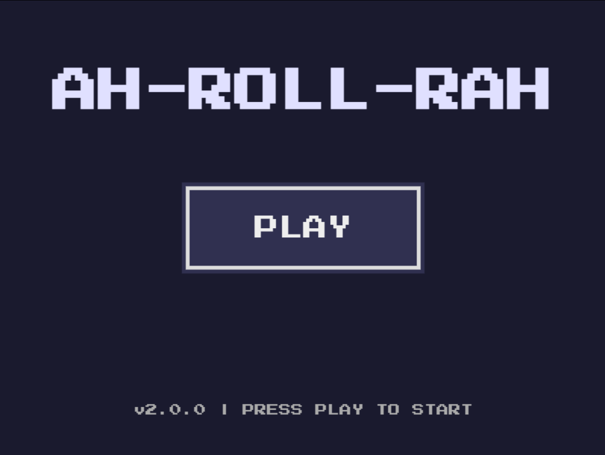
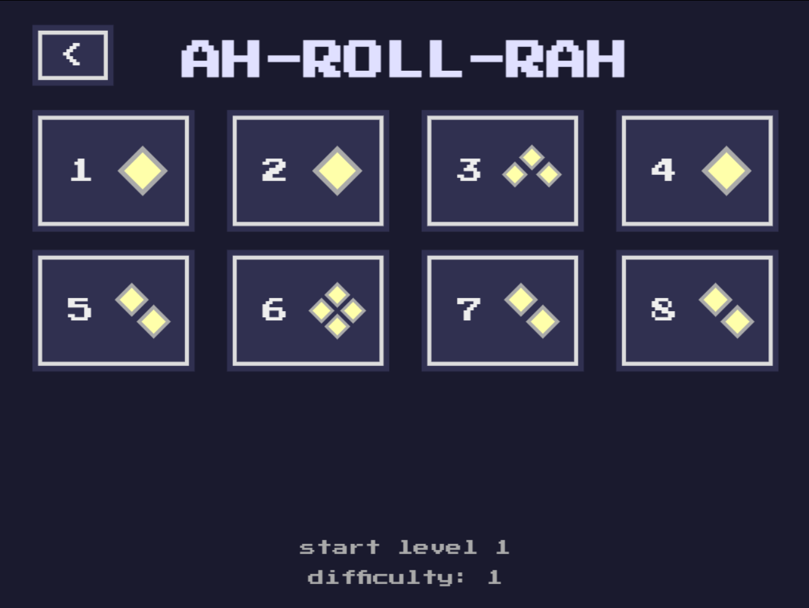
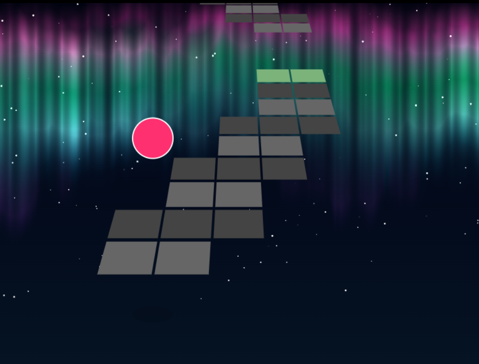

<h1 align="center"><b>
    <a href="https://klhrd.github.io/ah-roll-rah/">
        AH-ROLL-RAH
    </a>
</b></h1>

An action-packed 3D ball-rolling platformer where you steer a high-speed ball through narrow, suspended tracks to reach the finish line. This project was originally created for **Tagless**, a Hack Club event.

## Preview

<table align="center" border="0" cellpadding="0" cellspacing="10">
    <tr>
        <td width="33%"></td>
        <td width="33%"></td>
        <td width="33%"></td>
    </tr>
    <tr>
        <td>Home</td>
        <td>Menu</td>
        <td>Game</td>
    </tr>
</table>

## Build With

- HTML5 + CSS + JS
- Python ( for building level list and template )
- JSON ( level data )

## Getting Started

You can run this project in two ways:

1. Direct Link
    - [Github Page](https://klhrd.github.io/ah-roll-rah/)
2. Run Locally
    -  Clone or download the repository, then host it using a local development server (like VS Code's Live Server) to run it locally via ES6 modules.
